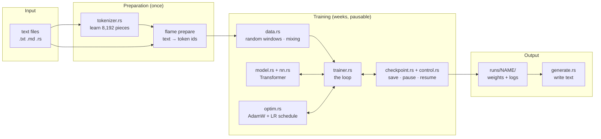
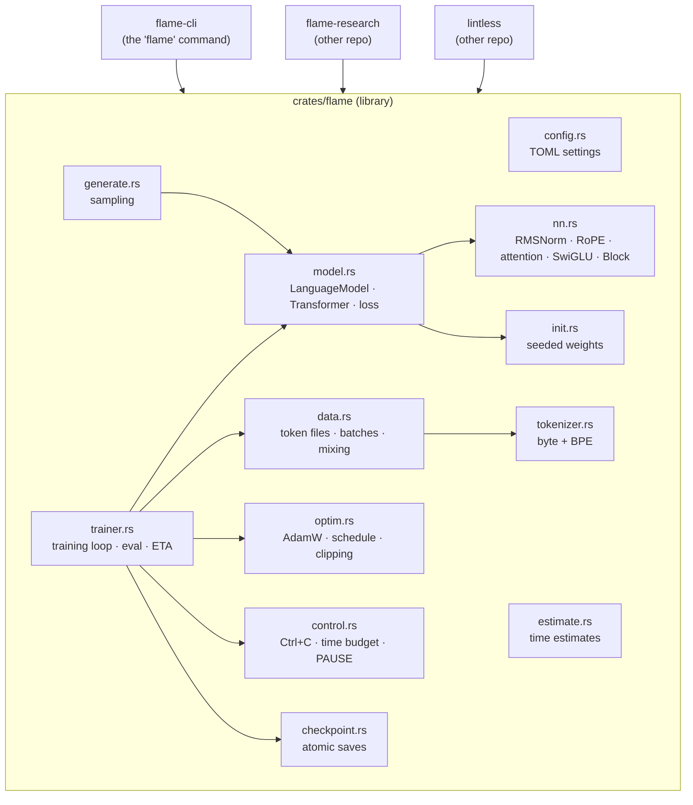
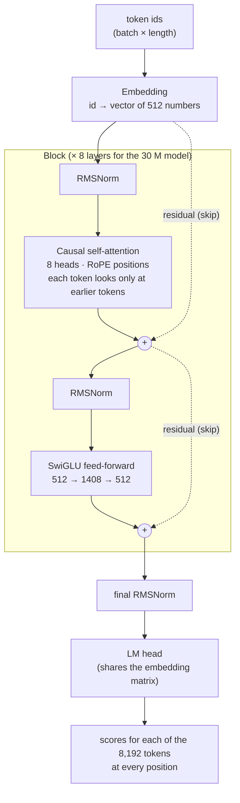
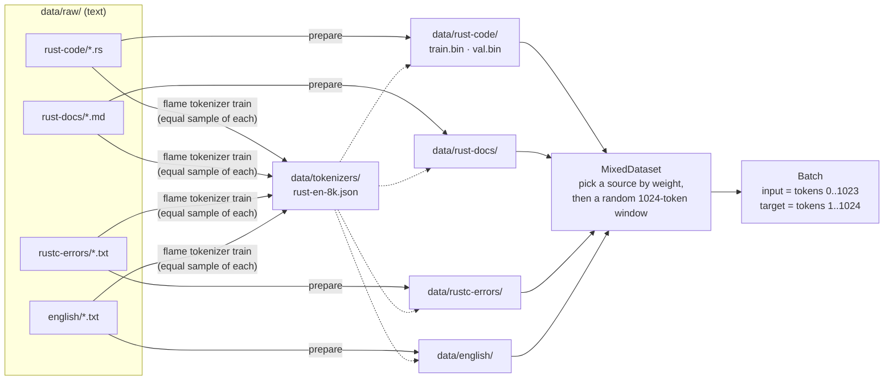
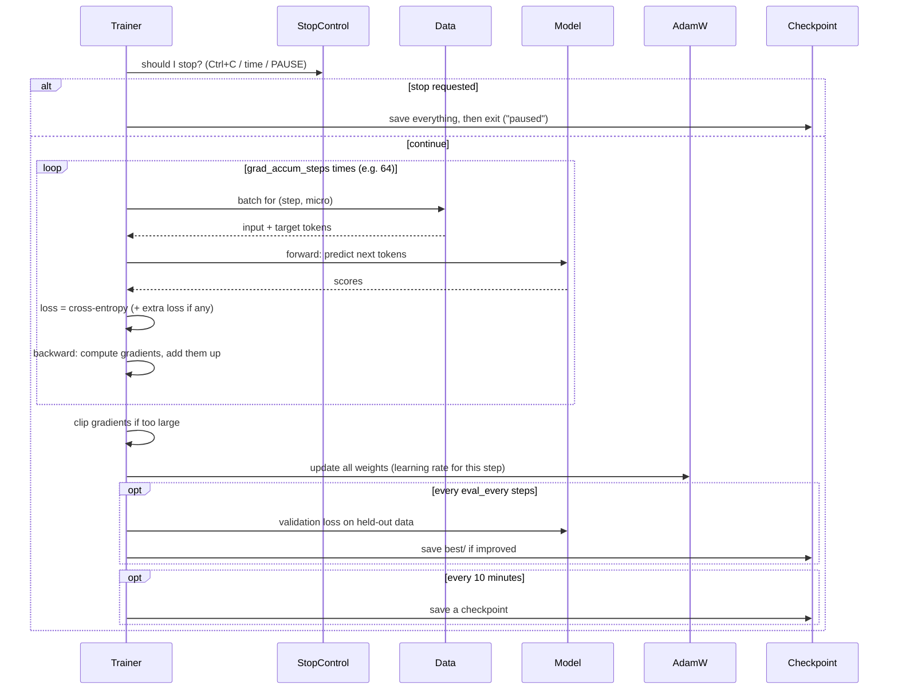
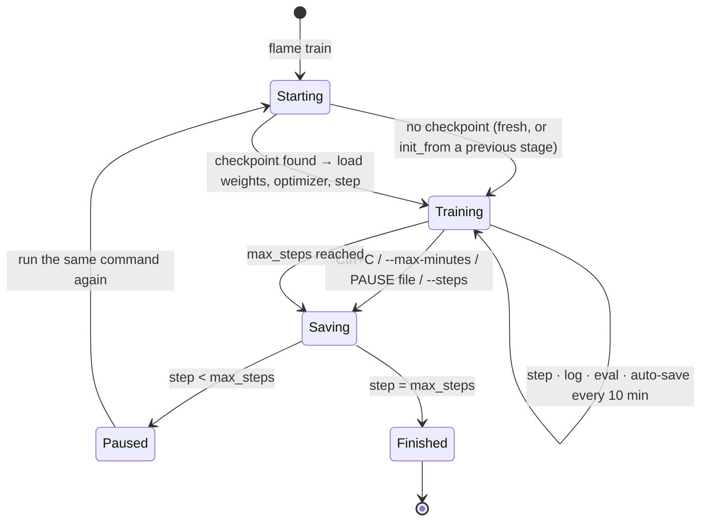
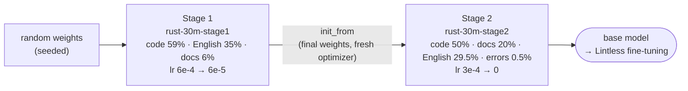
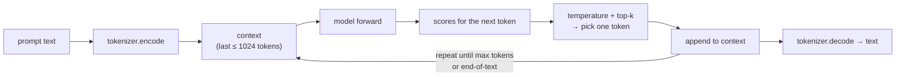

# FLAME architecture and data flow

How FLAME is built: the parts of the code, how the model is put together, and how data
flows from a text file to a trained model and back out as generated text. The diagrams are
drawn by GitHub automatically (Mermaid). For the *why* behind each decision, see
[developer-guide.md](developer-guide.md).

---

## 1. The big picture



---

## 2. Code structure

FLAME is a Cargo *workspace* with two crates: a library (all the logic) and a command-line
program that calls it. flame-research and Lintless use the library directly.



| file | job | size |
|---|---|---|
| `config.rs` | reads the `.toml` config: `[model]`, `[train]`, `[data]` | ~230 lines |
| `tokenizer.rs` | splits text into tokens; trains the BPE dictionary | ~430 |
| `data.rs` | memory-maps token files; builds batches; mixes several datasets by weight | ~330 |
| `nn.rs` | the building blocks of the Transformer | ~190 |
| `model.rs` | the full model; the `LanguageModel` interface; the loss | ~150 |
| `init.rs` | reproducible random starting weights | ~70 |
| `optim.rs` | AdamW optimizer (with saveable state), learning-rate schedule | ~130 |
| `trainer.rs` | the training loop: steps, logging, evaluation, checkpoints, pausing | ~290 |
| `control.rs` | detects Ctrl+C, the time budget and the PAUSE file | ~110 |
| `checkpoint.rs` | crash-safe saving and loading | ~110 |
| `generate.rs` | writes text with temperature / top-k | ~80 |
| `flame-cli/src/main.rs` | the `flame` command and all its sub-commands | ~560 |

---

## 3. The model (a LLaMA-style Transformer)



What each part does, in plain words:
- **Embedding**: turns each token id into a list of numbers the model can compute with.
- **Causal self-attention**: each position gathers information from *earlier* positions (never
  later ones, which would be cheating). **RoPE** encodes *how far apart* two tokens are.
- **SwiGLU**: a small network applied to each position separately; it stores much of the "knowledge".
- **RMSNorm**: keeps the numbers at a stable size so training doesn't blow up.
- **Residual (skip) connections**: each block *adds* its result to its input, which makes deep models trainable.
- **LM head**: turns the final vectors into a score for every possible next token.

Sizes of the provided models:

| config | d_model | layers | heads | context | parameters |
|---|---|---|---|---|---|
| overfit | 64 | 2 | 4 | 64 | 0.12 M |
| tiny-shakespeare | 128 | 4 | 4 | 256 | 0.9 M |
| tinystories-5m | 256 | 6 | 8 | 256 | 5.9 M |
| rust-30m-stage1/2 | 512 | 8 | 8 | 1024 | ≈ 30 M |
| rust-100m-stage1/2 | 768 | 12 | 12 | 1024 | ≈ 91 M |

---

## 4. Data flow: text → training batches



Key facts:
- **Token files** are plain arrays of 16-bit numbers (`u16`), read by memory-mapping, so a
  2 GB file costs almost no RAM.
- **`flame prepare`** splits text into documents (by file, or by a separator such as
  `<|endoftext|>`), tokenises them in parallel, and sends every 50th document to `val.bin`.
- **Batches are deterministic:** which windows are read at step *s* depends only on the seed
  and *s*. That's why resuming after a pause gives exactly the same training.
- **Target = input shifted by one:** at every position, the model learns to predict the next token.

---

## 5. One training step



---

## 6. Saving, pausing and resuming



**Crash-safe saving:** a checkpoint is written to `latest.tmp/`, then quickly swapped in
(`latest` → `latest.old`, `latest.tmp` → `latest`, delete `latest.old`). If the power goes out
at any moment, a complete checkpoint still exists.

**What's in a run folder:**

```text
runs/rust-30m-stage1/
├── config.toml               the config, frozen at the start
├── checkpoints/latest/
│   ├── model.safetensors     all weights
│   ├── optim.safetensors     the optimizer's memory (AdamW m and v)
│   └── state.json            step, tokens seen, hours trained, best val loss
├── best/model.safetensors    weights with the best validation loss
├── metrics.jsonl             one line per log/eval
└── sessions.log              when each session started and why it stopped
```

---

## 7. Staged pre-training



Both stages use the **same model shape and the same tokenizer** (checked at start).
`init_from` is used only in the first session of stage 2; after that, stage 2 resumes from its own checkpoints.

---

## 8. Generation (writing text)



Currently the whole context is re-read for every new token (there is no KV cache yet). That's
simple but slow for long outputs; a KV cache is on the roadmap.

---

## 9. Tokenizer format

| ids | meaning |
|---|---|
| 0–255 | the 256 possible bytes, so *any* text can be encoded, even unseen characters |
| 256 | `<|endoftext|>`: the document separator |
| 257 | `<|pad|>`: padding (ignored by the loss) |
| 258 … 8191 | learned pieces (BPE merges), e.g. ` fn`, `impl`, ` the`, `ing` |

Saved as JSON (the list of merges), e.g. `data/tokenizers/rust-en-8k.json`.
