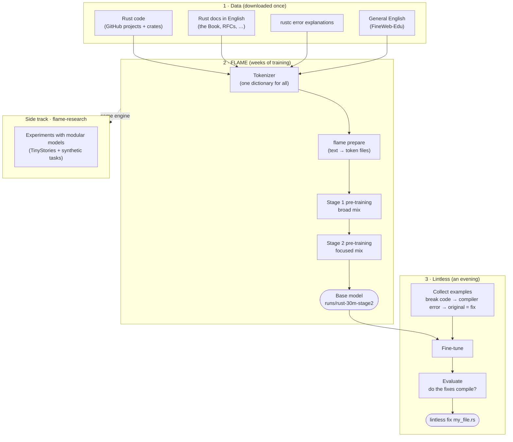
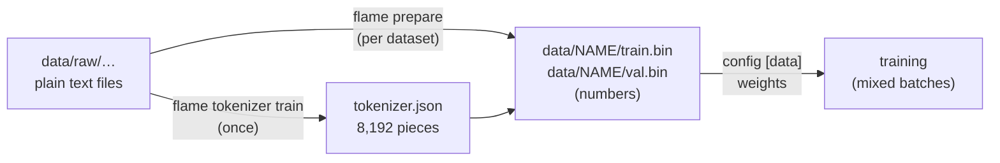

# The complete guide to FLAME, flame-research and Lintless

**Who this is for:** you, starting from zero. It assumes you can open a terminal and type
commands, and nothing else. Every idea is explained the first time it appears.

**How to read it:** read Parts 1–3 once (about 30 minutes). Then use Parts 4–8 as a manual:
come back to the part you need while you work.

| part | what's in it |
|---|---|
| [1. What is this project?](#1-what-is-this-project) | the goal, the three repositories, where we are |
| [2. Basic things to know](#2-basic-things-to-know) | computer basics + machine-learning basics, in plain words |
| [3. How everything fits together](#3-how-everything-fits-together) | one picture of the whole system |
| [4. One-time setup](#4-one-time-setup) | installing everything on the laptop |
| [5. The datasets](#5-the-datasets) | what data we use, where it comes from, how it's collected |
| [6. Every command explained](#6-every-command-explained) | `cargo`, `git`, `flame`, `flame-research`, `lintless` |
| [7. The step-by-step journey](#7-the-step-by-step-journey) | the whole plan, week by week, with your time budget |
| [8. Reading the output](#8-reading-the-output) | what the numbers on screen mean |
| [9. When something goes wrong](#9-when-something-goes-wrong) | the most common problems and their fixes |

Next document: [02-getting-the-most.md](02-getting-the-most.md) (how to get the best
results out of your time and your laptop).

---

## 1. What is this project?

### The goal in one sentence

Build a small AI model, from scratch and on one laptop, that **understands Rust and English
well enough to explain and fix Rust compiler errors**. Along the way, research whether AI
models can be built to use far less memory and computation.

### An analogy

Think of training a model like educating a student:

| education | our project |
|---|---|
| a student who has never read anything | a new model: random numbers, knows nothing |
| years of reading books, code and articles | **pre-training**: the model reads billions of words of Rust code and English |
| a short specialised course ("how to fix compiler errors") | **fine-tuning**: the model studies thousands of error → fix examples |
| an exam with questions it has never seen | **evaluation**: we test it on errors it never saw, and check whether its fixes compile |
| the graduate doing the job | **using it**: `lintless fix my_file.rs` |

### The three repositories

A *repository* ("repo") is a project folder tracked by git (version control). We have three:

| repo | role | analogy |
|---|---|---|
| **FLAME** (Framework for Lightweight AI Model Engineering) | the engine: reads text, builds the model, trains it, saves progress, generates text | the school building + teachers |
| **flame-research** | experiments with a new kind of model that only uses the parts it needs | a research lab inside the school |
| **lintless** | the application: turns a FLAME model into a Rust-error fixer | the specialised course + the graduate's job |

All three are written in **Rust** and use **Candle** (a small machine-learning library for
Rust). They live side by side in one folder, `~/code/`, because research and Lintless use
FLAME's code directly.

### Where we are

- ✅ **All the code is written and tested**: the model, the trainer (with pause/resume), data
  tools, the research experiments, and the Lintless pipeline.
- ⏳ **Nothing big has been trained yet.** That needs your GPU time (weeks of evenings and weekends).
- The first target is a **30-million-parameter** model. If it isn't good enough, we go to 100 million.

---

## 2. Basic things to know

### 2.1 Computer basics

**Terminal / shell.** A window where you type commands instead of clicking. Each line you
type is a command; press Enter to run it. In this guide, commands are in grey boxes. Lines
starting with `#` are comments (explanations); you don't type them.

**WSL2 (Windows Subsystem for Linux).** Lets you run Linux inside Windows. We use it because
the GPU tools and Rust work most smoothly on Linux. You open it by typing "Ubuntu" in the
Windows start menu.

**Paths.** `~` means your home folder. `~/code/FLAME` means the folder FLAME inside the
folder code inside your home folder. `.` means "the current folder", `..` means "the folder above".

**git.** Tracks every version of the code. `git clone <url>` downloads a repository;
`git pull` gets the latest changes. GitHub is the website where the repositories are stored.

**Rust, cargo.** Rust is the programming language. `cargo` is Rust's tool that builds
(compiles) programs, downloads the libraries they need, and runs tests.

**Build / compile.** Turning source code into a program you can run. After building, the
programs are in `target/release/` (for example `target/release/flame`).

**GPU, VRAM, CUDA.** The graphics card (RTX 3070 Ti) does the arithmetic of training ~20–100×
faster than the processor (CPU). VRAM is the graphics card's own memory (8 GB), and it limits
how big a model and batch can be. CUDA is NVIDIA's software that lets programs use the GPU.

**Config file (`.toml`).** A small text file with settings, for example the model size and
learning rate. You pass it to a command with `--config`.

### 2.2 Machine-learning basics (the minimum)

**Model.** A big mathematical function with millions of adjustable numbers (**parameters**
or **weights**). Ours takes text in and predicts which piece of text comes next.

**Token.** Text is cut into pieces called tokens: a word, part of a word, or a symbol. For
example `fn main() {` → `fn`, ` main`, `()`, ` {`. The model only sees token numbers.

**Tokenizer / vocabulary.** The fixed dictionary of pieces (ours has 8,192) and the rules for
cutting text into them. It is made **once** before training and never changes afterwards.

**Training.** Show the model text, let it guess each next token, measure how wrong it was
(**loss**), and nudge all parameters slightly to be less wrong. Repeat thousands of times.
Each repetition is a **step**.

**Loss.** "How wrong the guesses are." Lower is better. It falls quickly at first, then slowly.

**Validation loss.** Loss on text the model *never trains on*. It tells you whether the model
is really learning or just memorising. If training loss keeps falling but validation loss
rises, it's memorising (**over-fitting**).

**Perplexity.** Another view of loss: roughly how many options the model is hesitating
between. Perplexity 5 means "it's choosing between about 5 likely next tokens".

**Batch.** How much text one step reads (ours ≈ 131 000 tokens). **Gradient accumulation**
reads a big batch in small parts so it fits in 8 GB.

**Epoch.** One full pass over a dataset. Reading data 1–4 times is good; 20 times means memorising.

**Learning rate.** How big each nudge is. It starts at zero, rises during **warm-up**, then
slowly falls back towards zero (a cosine schedule).

**Checkpoint.** A saved copy of everything needed to continue: weights, optimizer state and
step number. This is what makes **pausing** possible.

**Pre-training vs fine-tuning.** Pre-training = long general reading (weeks). Fine-tuning =
short specific course (an hour), starting from the pre-trained model.

**Stages.** We split pre-training in two: stage 1 reads a broad mix; stage 2 continues from
stage 1 with more focused data and a lower learning rate. Some stage-1 data stays in the mix
(**replay**) so nothing is forgotten.

**Data mix / weights.** Pre-training reads several datasets at once. "English weight 0.35" =
35% of what the model reads is English.

**Baseline.** Something to compare against. A number means nothing on its own; "better than
X" does. For Lintless, the baseline is the Rust compiler's own suggested fix.

More (with examples): [../beginners-guide.md](../beginners-guide.md).

---

## 3. How everything fits together



In words:
1. **Download** four kinds of text (Section 5).
2. FLAME builds **one tokenizer**, converts every dataset to token files, and **pre-trains in
   two stages**. The result is the **base model**: it can continue Rust code and English text.
3. Lintless **creates thousands of examples** (it breaks working code, records the
   compiler's error, and uses the original as the fix), **fine-tunes** the base model on them,
   **evaluates** it by compiling its fixes, and then you **use** it on your own files.
4. flame-research runs **separate experiments** using the same engine whenever the GPU is free.

---

## 4. One-time setup

Takes about 1–1.5 hours. Full details with screenshots-level steps: [../setup.md](../setup.md).

```bash
# ── in Windows PowerShell (as administrator): install Linux ──
wsl --install -d Ubuntu            # then restart the computer

# ── from now on, everything is in the Ubuntu terminal ──
sudo apt update && sudo apt install -y build-essential pkg-config git curl
#   ↑ basic build tools (compiler, git, downloader)

curl --proto '=https' --tlsv1.2 -sSf https://sh.rustup.rs | sh && source ~/.cargo/env
#   ↑ installs Rust and cargo

sudo apt install -y cuda-toolkit    # the CUDA toolkit for WSL (see setup.md for the exact repository)
echo 'export PATH=/usr/local/cuda/bin:$PATH' >> ~/.bashrc && source ~/.bashrc
nvidia-smi && nvcc --version        # both must print something → the GPU is usable

mkdir -p ~/code && cd ~/code        # one folder for all three repos
git clone https://github.com/RTensorLabs/FLAME
git clone https://github.com/RTensorLabs/FLAME-Research flame-research
git clone https://github.com/RTensorLabs/lintless

cd ~/code/FLAME          && cargo build --release --features cuda
cd ~/code/flame-research && cargo build --release --features cuda
cd ~/code/lintless       && cargo build --release --features cuda

# make the three programs available from any folder
echo 'export PATH="$HOME/code/FLAME/target/release:$HOME/code/flame-research/target/release:$HOME/code/lintless/target/release:$PATH"' >> ~/.bashrc
source ~/.bashrc
flame --help && flame-research --help && lintless --help
```

**Check:** `cargo test --release` in each of the three folders prints only `test result: ok`.

---

## 5. The datasets

### 5.1 Overview

| dataset | what it is | used for | how we get it | size |
|---|---|---|---|---|
| overfit paragraph | one paragraph of text | first sanity test | already in the repo (`examples/overfit.txt`) | 1 KB |
| Tiny Shakespeare | all of Shakespeare's plays | first real training run | one download (`curl`) | 1 MB |
| TinyStories | millions of very simple short stories | small models, research | one download (`curl`) | 2.2 GB |
| **Rust code** | source code of ~37 big Rust projects + ~100 popular libraries | base model | `tools/fetch_corpus.sh code` | 1–3 GB |
| **Rust docs** | English explanations of Rust: the Book, Rust by Example, RFCs, … | base model | `tools/fetch_corpus.sh docs` | ≈ 40–120 MB |
| **rustc errors** | the compiler's long explanation of every error code | base model (stage 2) | `tools/fetch_corpus.sh errors` | 0.4 MB |
| **English** | educational web pages (FineWeb-Edu) | base model | `tools/fetch_corpus.sh english` | 1.5 GB |
| **Lintless examples** | broken code + compiler error + fix | fine-tuning | generated by `lintless collect-*` | grows as you collect |

### 5.2 How each one is collected

- **Rust code.** The script downloads each project with `git clone --depth 1` (only the
  latest version, no history), keeps only `.rs` files and deletes the rest. For popular
  libraries ("crates") it creates a throw-away Rust project, adds the crate as a dependency,
  and runs `cargo fetch`: cargo downloads the crate *and everything it depends on* into
  `~/.cargo/registry/src`. That folder is then used as extra code.
- **Rust docs.** Same `git clone` trick for the official Rust books and the RFC repository
  (RFCs are design documents explaining Rust features), keeping only Markdown (`.md`) text.
  The Markdown files of the code projects (their READMEs and docs) are also moved here.
- **rustc errors.** Your installed Rust compiler knows a long explanation for every error
  code: `rustc --explain E0382`. The script asks it for all ~500 codes and saves them.
- **English.** FineWeb-Edu is a public collection of educational web pages stored as
  *parquet* files (a compressed table format) on Hugging Face. `tools/fetch_english.py`
  downloads one file at a time, extracts the text column, writes it as plain text, and
  deletes the parquet file. It stops at 1.5 GB of text (changeable with `ENGLISH_MB`).
- **TinyStories / Shakespeare.** Single text files, downloaded directly with `curl`.
- **Lintless examples.** Not downloaded but *manufactured*: take code that compiles, break
  one line the way people really do (remove `mut`, forget `&`, typo a name…), run the
  compiler, and record its error. The original line is the correct fix. Every example is
  verified by the compiler.

All downloaded data goes into `FLAME/data/raw/…` and is **never uploaded to GitHub**. Links,
licences and exact commands: [../datasets.md](../datasets.md).

### 5.3 What happens to the data



1. **Tokenizer training** reads a sample of *all* datasets and learns the 8,192 most useful pieces.
2. **Prepare** cuts every text into tokens and writes them as numbers into `train.bin` (98%) and
   `val.bin` (2%, the held-out validation part).
3. **Training** reads from several prepared datasets at once, in the proportions (weights)
   written in the config file.

---

## 6. Every command explained

Pattern for all commands: `program command --option value`. Every program has `--help`,
and every command too (e.g. `flame train --help`).

### 6.1 cargo and git (tools)

| command | what it does | when |
|---|---|---|
| `cargo build --release --features cuda` | compiles the program with GPU support, optimised | after setup and after every `git pull` |
| `cargo build --release` | same, without GPU (CPU only) | if you have no NVIDIA GPU |
| `cargo test --release` | runs all automatic checks | after building; after changing code |
| `cargo clippy --all-targets` | checks the code for common mistakes and style | before committing code changes |
| `git pull` | downloads the latest version of the repo | when the code was updated |
| `git status` | shows what you changed locally | anytime |

### 6.2 `flame` (FLAME)

| command | what it does, in plain words |
|---|---|
| `flame tokenizer byte --out F` | makes the simplest tokenizer (one token per letter/byte). For the first tests. |
| `flame tokenizer train --input A B … --vocab-size N --out F` | learns a dictionary of N pieces from a sample of the input folders/files |
| `flame prepare --input A … --tokenizer F --out D` | converts text files into token files `D/train.bin` + `D/val.bin` |
| `flame params --config C` | prints how big the model in config C is (parameters, memory) |
| `flame estimate --config C --tflops X` | predicts how many hours training will take at speed X |
| `flame train --config C --run R` | trains (or **resumes** training) the model described in C; saves everything in folder R |
| `flame status --run R` | progress: % done, hours so far, time left, measured speed |
| `flame generate --run R --prompt "…"` | lets the model write text continuing your prompt |
| `flame eval --run R` | measures validation loss (per dataset for mixes) |
| `flame export-reference --config C --out D` | developer check: compare FLAME's maths with PyTorch |

**Important options:**

| option | meaning |
|---|---|
| `--run R` | the folder where a training run lives, e.g. `runs/rust-30m-stage1`. Same folder = same run (resume) |
| `--max-minutes N` | train for at most N minutes, then save and stop cleanly |
| `--steps N` | train at most N steps in this session |
| `--fresh` | start the run over (the old folder is renamed to a backup, never deleted) |
| `--cpu` | force the CPU even if a GPU exists |
| `--temperature T` (generate) | 0 = always the most likely token (repetitive); 0.5–0.8 = natural; > 1 = chaotic |
| `--top-k K` (generate) | only pick among the K most likely tokens |
| `--max-tokens N` (generate) | how much text to write |
| `--latest` (generate/eval) | use the newest checkpoint instead of the best one |
| `--ext rs,md,txt` (tokenizer/prepare) | which file types to read from folders |
| `--separator "…"` (prepare) | how documents are separated inside one big file (`\n\n` = paragraphs) |
| `--val-fraction 0.02` (prepare) | share of documents kept aside for validation |
| `--sample-mb N` (tokenizer train) | how many MB of text to learn the dictionary from |

**Examples:**

```bash
flame train --config configs/rust-30m-stage1.toml --run runs/rust-30m-stage1 --max-minutes 45
#   train stage 1 for 45 minutes; next time, the same command continues where it stopped

flame generate --run runs/rust-30m-stage2 --prompt "fn main() {" --temperature 0.7 --max-tokens 150
#   ask the model to continue the code

flame status --run runs/rust-30m-stage1
#   how far along is it, and how long is left?
```

### 6.3 `flame-research`

| command | what it does |
|---|---|
| `flame-research train --config C --run R` | trains a dense, MoE or modular model (same pause options as `flame train`) |
| `flame-research params configs/*.toml` | size and computation of each config, to check comparisons are fair |
| `flame-research eval-tasks --run R` | for synthetic tasks: accuracy and "thinking steps" per difficulty level |
| `flame-research trace --run R --out F` | records which module each token used |
| `flame-research simulate --trace F` | pretends the model runs with limited GPU memory; reports slowdowns |
| `flame-research compare runs/…` | one table comparing several runs side by side |

### 6.4 `lintless`

| command | what it does |
|---|---|
| `lintless collect-seeds` | makes examples from the small programs in `seeds/` (seconds) |
| `lintless collect-project DIR --out F` | makes examples from a real Rust project (in a copy; yours is never changed) |
| `lintless collect-clippy DIR --out F` | makes examples from clippy's automatic fixes |
| `lintless split data/raw/*.jsonl --out data` | divides all examples into training and test sets |
| `lintless train --config C --run R` | fine-tunes the base model (pausable like `flame train`) |
| `lintless eval --run R` | tests the fine-tuned model: do its fixes compile? compared with rustc's suggestions |
| `lintless fix FILE` | explains and fixes the first error in FILE (`--apply` writes the fix, keeping a `.bak` backup) |

### 6.5 Pausing (works the same for every `train` command)

| to… | do this |
|---|---|
| stop now, safely | press **Ctrl+C** once and wait a few seconds (it saves) |
| stop after a set time | add `--max-minutes 45` |
| stop from another window | create an empty file named `PAUSE` in the run folder: `touch runs/NAME/PAUSE` |
| continue later | run **exactly the same command** again |

Pressing Ctrl+C **twice** quits immediately without saving (you lose at most the last 10
minutes, because a checkpoint is also saved automatically every 10 minutes).

---

## 7. The step-by-step journey

Your time: about **3–4 hours at weekends** and **0–1 hour on weekdays**, about 6 hours of
GPU time per week. Detailed commands for each step: [../end-to-end-guide.md](../end-to-end-guide.md)
(FLAME), `lintless/docs/end-to-end-guide.md`, and `flame-research/docs/end-to-end-guide.md`.

| when | what | commands (short) | result |
|---|---|---|---|
| **Weekend 1** | setup, build, tests | Section 4 | three programs working |
| | sanity runs (≈ 30 min) | `flame train --config configs/overfit.toml …`, then Tiny Shakespeare | loss ≈ 0.05; Shakespeare-like text; your GPU speed |
| | start downloads (unattended) | `tools/fetch_corpus.sh all` | `data/raw/…` filled |
| **Week 2** | tokenizer + prepare (unattended) | `flame tokenizer train …`, `flame prepare …` ×4 | `data/rust-code`, `data/english`, … |
| | start **stage 1** | `flame train --config configs/rust-30m-stage1.toml --run runs/rust-30m-stage1 --max-minutes 45` | the data plan printed; training running |
| **Weeks 2–6** | continue stage 1 each session | the same command | loss going down; `flame status` |
| | meanwhile on the CPU: Lintless data | `lintless collect-seeds`, `collect-project …` | thousands of examples |
| | when the GPU is free: research | `flame-research train …` | experiment results |
| **Weeks 6–8** | **stage 2** | `flame train --config configs/rust-30m-stage2.toml --run runs/rust-30m-stage2 --max-minutes 45` | the base model |
| **One evening** | fine-tune Lintless | `lintless split …`, `lintless train …` | `runs/lintless-30m` |
| **One evening** | evaluate + decide | `lintless eval --run runs/lintless-30m` | good enough → use it; otherwise more data or 100 M |
| **After** | use it | `lintless fix my_file.rs` | help with real errors |

---

## 8. Reading the output

A typical training line:

```text
[flame] step   1200/7500 | loss 2.1340 | lr 5.87e-4 | gnorm 0.42 | 31000 tok/s | ETA 18.4 h (≈19 sessions of 1 h)
```

| part | meaning | healthy |
|---|---|---|
| `step 1200/7500` | step done / total steps | increases |
| `loss 2.1340` | how wrong the guesses are (training data) | falls, fast at first, then slowly |
| `lr 5.87e-4` | current learning rate (5.87 × 10⁻⁴ = 0.000587) | rises during warm-up, then slowly falls |
| `gnorm 0.42` | size of the latest correction | mostly below 1–2 |
| `31000 tok/s` | speed: tokens read per second | stays roughly constant |
| `ETA 18.4 h` | estimated training time left | shrinks |

Every `eval_every` steps:

```text
[flame]   eval @ 1500 | val_loss 2.2010 | ppl 9.03 | new best ✓
```

`val_loss` = loss on unseen data (should follow `loss`). `ppl` = perplexity. `new best ✓` = the
best model so far was saved to `runs/NAME/best/`.

At the start of a mixed run, the **data plan**:

```text
  rust-code      weight  59.0%  data  612.4 M tokens  drawn  580.0 M  ≈  0.9 epochs
```

"weight" = share of the mix; "data" = how much of this dataset exists; "drawn" = how much
this run will read; "epochs" = how many times it will re-read it. A ⚠ appears above 16 epochs.

---

### 7.1 Faster: a rented GPU

With cloud credit (e.g. vast.ai), the whole 30 M model trains in a few hours on one H100,
A100 or RTX 4090 for a few dollars, instead of weeks on the laptop. Follow
[../cloud-gpu-guide.md](../cloud-gpu-guide.md): it covers choosing the GPU, cost, a one-command
setup script, training, and copying the results home.

---

## 9. When something goes wrong

| symptom | cause | fix |
|---|---|---|
| `running on CPU` although you have a GPU | built without GPU support | `cargo build --release --features cuda` |
| `command not found: flame` | program not on PATH | run the `export PATH=…` line from Section 4, or use `./target/release/flame` |
| `out of memory` | batch too big for 8 GB | in the config: halve `micro_batch_size`, double `grad_accum_steps` |
| `loss became NaN` | learning rate too high | lower `lr` (e.g. divide by 2) and restart with `--fresh` |
| `[model]/[data] differ from the run's frozen config` | you changed the model after starting | use a new `--run` folder, or `--fresh` |
| very slow | laptop overheating, or code under `/mnt/c` | cooling pad, plugged in; keep code in `~/code` |
| ⚠ "heavily repeated" in the data plan | a dataset is too small for its weight | lower its weight or download more of it, before training long |
| validation loss rises while loss falls | memorising | stop; use the `best/` model; for fine-tuning, fewer epochs |
| a test fails | something is broken | don't train; report the failing test name |

More: [../troubleshooting.md](../troubleshooting.md).
